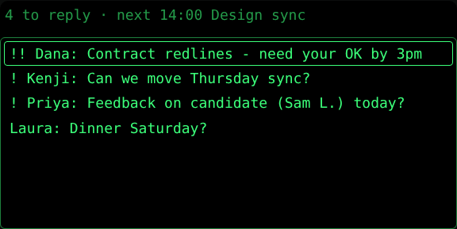
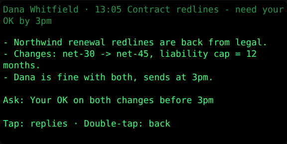
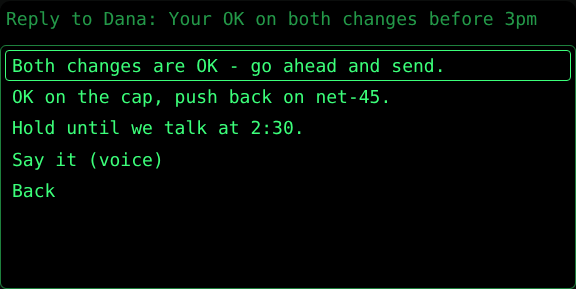

# Nod — reply to the one email that needs you, from your Even G2

**Track: AI Assistants & Work** (Claude + Google Workspace: Gmail, Calendar)

Between meetings, pulling out your phone to "just check email" turns into ten minutes. Nod puts only the threads that need *you* on the G2's 576×288 display. Claude reduces each one to three lines and the one thing the sender is asking for, and offers three ready replies. Pick one with the R1 ring or a temple tap and Nod saves it as a Gmail draft — **three taps from inbox to reply**. Say a reply out loud and Claude turns your dictation into a proper email. Double-tap for your next meeting and the email that matters for it.

| Home | Brief | Reply |
|---|---|---|
|  |  |  |

## Try it in 1 minute (no account, no keys)

```bash
npm install
npm run dev                       # http://localhost:5173/?demo=1
npx evenhub-simulator http://localhost:5173/?demo=1
```

The demo inbox (8 fictional emails, 4 that need a reply) runs entirely in the app, so the whole flow works in the simulator with no backend. In a normal browser the page shows a preview of the lens: arrows to move, Enter = tap, Backspace = double-tap, `l` = long-press.

## Controls

| Where | Tap | Double-tap | Long-press | Menu |
|---|---|---|---|---|
| Home | open thread | next meeting | — | Snooze 1h · Mark done · Next meeting · Refresh |
| Brief | show replies | back | — | 〃 |
| Reply | save as **draft** | back | send (asks to confirm) | 〃 |
| Voice | stop listening | cancel | — | 〃 |

Sending is never one gesture: the default is a Gmail draft, and sending needs a second, explicit choice ("Send it now" on the result screen, or long-press → "Send now"). Long-press is a shortcut only, because the OS also uses long-press for its own menu — every action has a tap path.

## How it works

```
G2 ──BLE── Even App (WebView: Nod, Even Hub SDK 0.0.16)
                    │  fetch, one whitelisted host, pairing code only
                    ▼
            Nod backend (server/index.mjs, Node 20, zero dependencies)
             ├─ Claude (claude-haiku-5-5): 3-line brief + 3 replies, dictation → reply, needs-a-reply triage
             ├─ Gmail REST: unread threads, create draft, send draft, mark read
             ├─ Calendar REST: next event
             └─ Speech-to-text: glasses mic PCM (16 kHz) → WAV → Whisper
```

- `src/core.js` — the whole app as a pure state machine: `view(state)` returns a page for the 576×288 display, `step(state, input)` returns the next state and side effects. The same code drives the glasses, the phone-side preview and the tests (`npm test`).
- `src/glasses.js` — renders a page with `createStartUpPageContainer` / `rebuildPageContainer`, and uses `textContainerUpgrade` when only text changed (keeps BLE traffic small). Maps list/text/sys/menu events to inputs.
- Uses list containers, text containers with brightness levels (0–4) for hierarchy, the contextual menu (`menuObject`), long-press events, and the glasses microphone (`audioControl` + `audioEvent`).
- Every list label is cut to ≤ 63 UTF-8 bytes and every menu label to ≤ 32.

### Privacy and safety

- Keys (Claude, OpenAI, Google) live only on the backend. The app holds a 6-digit pairing code.
- Google sign-in can't run in the WebView, so you open `/pair` on the backend in your phone's browser, sign in, and type the code shown into Nod.
- Mail bodies stay in backend memory for the session; only the Google refresh token is written to disk (mode 600).
- Quoted history and signatures are stripped before a thread is sent to Claude.
- Drafts by default; sending needs a second choice.

## Run with your own Gmail

```bash
cp .env.example .env    # fill in the keys
set -a; . ./.env; set +a
npm run server          # backend on :8787 — expose it over HTTPS (e.g. a tunnel)
```

Create an OAuth client (Web application) in Google Cloud with redirect URI `PUBLIC_URL/oauth`, scopes `gmail.modify` and `calendar.readonly`. Put your backend's origin in `app.json` → `permissions[network].whitelist`, then in Nod open "Connect your Gmail", enter the backend URL and the pairing code.

With only `ANTHROPIC_API_KEY` set, the backend serves the demo inbox but writes every brief and reply live with Claude (pairing code `000000`).

## Package

```bash
npm run pack            # dist/ + app.json -> nod.ehpk
```

## What existed before the hackathon

Built during the hackathon (from 2026-11-23 17:00 JST). Pre-existing pieces used: Even Hub SDK 0.0.16, evenhub-cli 0.2.0, evenhub-simulator 0.9.5, Vite. No other code was reused.

## License

MIT
